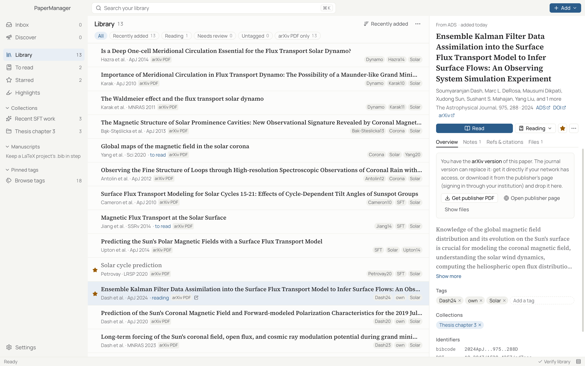
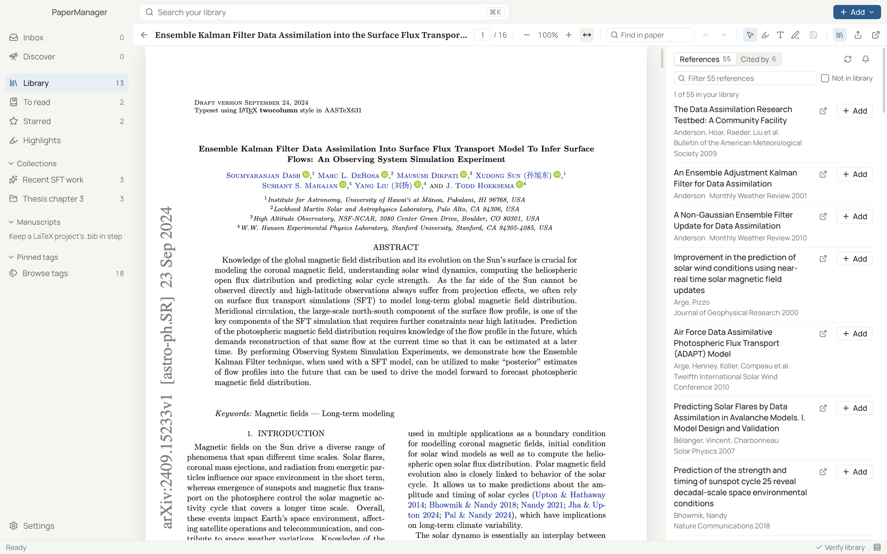
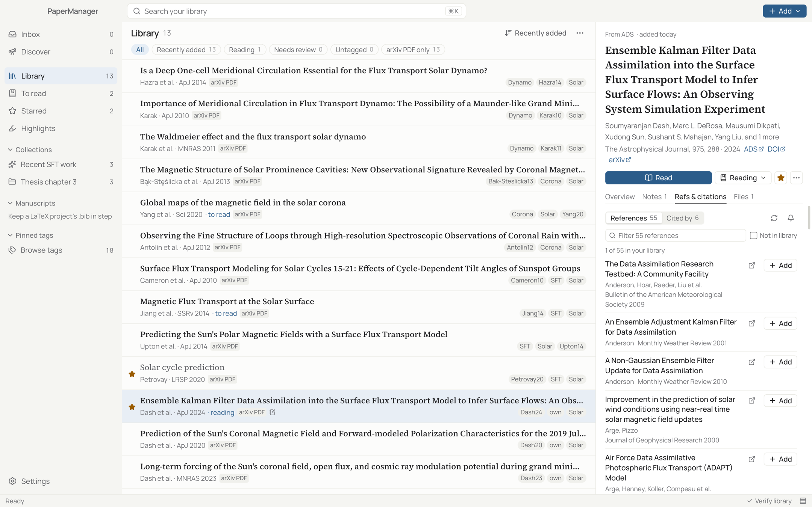
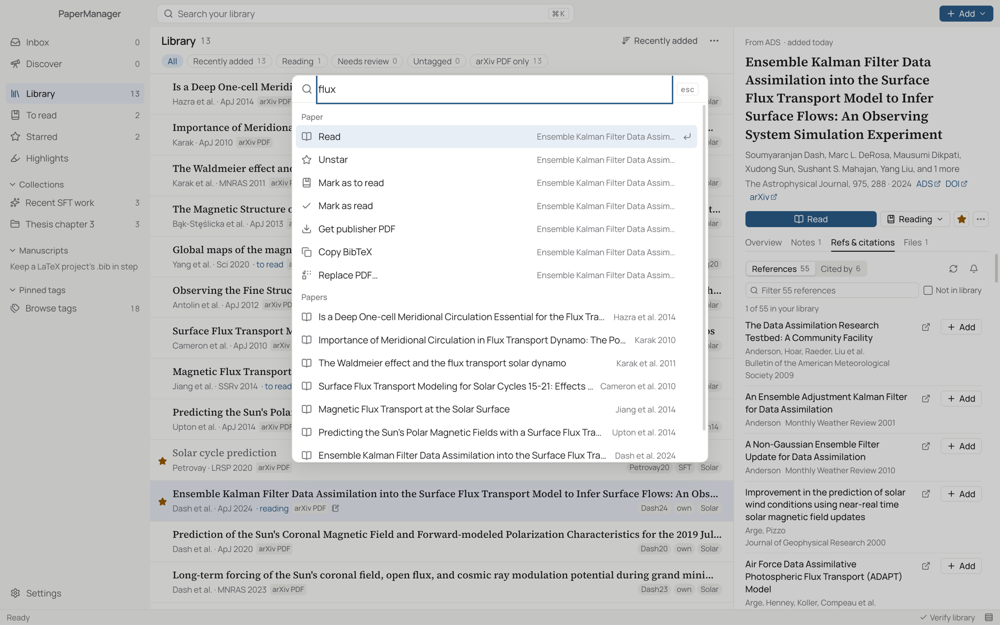

# PaperManager

[](https://github.com/sr-dash/PaperManager/actions/workflows/ci.yml)
[](https://github.com/sr-dash/PaperManager/releases)
[](https://doi.org/10.5281/zenodo.23935225)
[](LICENSE)


A durable, well-formed library for downloaded research literature: every PDF
filed once under a meaningful name, identified by ADS / DOI / arXiv, tagged,
full-text searchable, and verifiable against its own records.

> **Status: 0.6.** A macOS desktop app (Electron, React and Tailwind) on a TypeScript
> library core. The `pm` command line drives the same library.



<table>
  <tr>
    <td width="50%"></td>
    <td width="50%"></td>
  </tr>
  <tr>
    <td>Read with highlights, notes and drawings saved into the PDF; the paper's references and citations sit beside it, one click to add.</td>
    <td>References and citations from ADS, with the papers you already have marked.</td>
  </tr>
  <tr>
    <td></td>
    <td valign="top">
      <b>Highlights</b>
      <ul>
        <li>PDFs filed once, as <code>Family_Year_Journal_Vol_Page.pdf</code></li>
        <li>Metadata from ADS, Crossref and arXiv; BibTeX export</li>
        <li>Full-text search with a filter language and smart collections</li>
        <li>An Inbox that finds new papers in Downloads</li>
        <li>arXiv copies swapped for the journal version when you get it</li>
        <li>⌘K: jump to any paper, place or action</li>
        <li>Manuscript bibliographies kept in step with the library</li>
        <li>Your library is a plain folder you own</li>
      </ul>
    </td>
  </tr>
</table>

## Install

PaperManager is installed by building it on your own Mac, which takes a minute or two.
An app built where it runs opens without macOS's "unidentified developer" warning, so
no Apple signing is needed.

1. Install [Node.js](https://nodejs.org) 22.13 or newer (the LTS installer). Git comes
   with Apple's command line tools: run `git` once and macOS offers to install them.
2. Get the source and run the installer:

   ```bash
   git clone https://github.com/sr-dash/PaperManager.git
   cd PaperManager
   ./scripts/install.sh
   ```

   It installs the dependencies, runs the unit tests, builds the app for your Mac
   (Apple Silicon or Intel), puts it in `/Applications` (or `~/Applications` if that is
   not writable) and opens it. The first run downloads Electron, about 100 MB.

3. [Set up your ADS token](#set-up-your-ads-token) so lookups, references and citations
   work.
4. To update later, from the same folder: `./scripts/install.sh --update`. It pulls the
   latest commits, rebuilds, quits the running app and replaces it; the old copy goes to
   the Trash.

To install a particular release instead of the latest commit, check out its tag first
(`git checkout v0.6.1`). Other options: `--dest DIR`, `--no-launch`, `--skip-tests`.

Your library is a separate folder (`~/Documents/PaperManager` by default) and is never
touched by installing, updating or removing the app. A newer app upgrades the library's
database on first open, and an older app then refuses to open it rather than damage it,
so update every Mac that shares a library.

**Building on Linux:** `npm ci && npm run build && npx electron-builder --linux AppImage`
produces `dist/PaperManager-<version>-<arch>.AppImage`.

## Set up your ADS token

PaperManager gets paper details, references and citations from
[NASA ADS](https://ui.adsabs.harvard.edu). ADS needs a personal API token, which is
free. Without one the app still works: DOIs are looked up through Crossref and arXiv ids
through arXiv. But bibcodes, title matches, references and citations, Discover and the
check for journal versions of preprints all need ADS.

### 1. Get the token from ADS

1. Go to [ui.adsabs.harvard.edu](https://ui.adsabs.harvard.edu) and sign in. If you have
   no ADS account, choose **Sign Up**; it is free.
2. Open the **Account** menu at the top right and choose **Settings**.
3. In the list on the left, choose **API Token**
   ([direct link](https://ui.adsabs.harvard.edu/user/settings/token)).
4. Click **Generate a new key** if no token is shown yet. Copy the token: a string of
   about 40 letters and digits.

Treat the token like a password. Don't paste it into email, chat or a shared file. If
it leaks, generate a new one on the same page; the old one stops working.

### 2. Give it to PaperManager

**In the app (recommended).**

1. Open PaperManager and choose **Settings** at the bottom of the sidebar (or press
   **⌘,**).
2. In the **ADS** section, paste the token into the box and click **Save**.
3. Click **Test**. "ADS accepted the token" means it works. The **Token** line now says
   "Set, saved in PaperManager (encrypted with your keychain)".

The token is encrypted with your macOS keychain and stored only on this Mac. It is
never written anywhere in plain text, and it isn't part of your library folder, so set
it again on each Mac you use. macOS may ask whether PaperManager can use its keychain
item, "PaperManager Safe Storage", the first time you save the token, and again after
you install a new version. Enter your Mac password and choose **Always Allow**.

To replace the token, paste the new one and click **Save**. To delete it, click
**Remove**.

**In a file, for the `pm` command line as well.** The `pm` command line doesn't read
the token saved in the app. If you also use `pm`, put the token in `~/.ads/dev_key`,
which the app reads too. Copy the token, then run this in Terminal:

```bash
mkdir -p ~/.ads
pbpaste > ~/.ads/dev_key
chmod 600 ~/.ads/dev_key
```

`pbpaste` writes what you copied, so the token never appears on screen or in your
shell history. `chmod 600` makes the file readable only by you. Restart PaperManager;
Settings then says "Set, from ~/.ads/dev_key". Other ADS tools that use the same file
pick it up too.

**From an environment variable.** `ADS_API_TOKEN` (or `ADS_DEV_KEY`) is read as well,
but only by programs started from a Terminal where it is set. An app opened from the
Dock, Finder or Spotlight doesn't see variables set in `~/.zshrc`, so don't rely on this
for everyday use. While it is set, it overrides the other two and the token box in
Settings is disabled.

When more than one is present, PaperManager uses the environment variable first, then
the token saved in the app, then `~/.ads/dev_key`. Settings always shows which one is
in use.

### If it doesn't work

- **Test reports an authorisation error:** the token was mistyped or has been
  replaced. Copy it again from the ADS **API Token** page, then **Save** and **Test**.
- **Settings says "Not set" after you created `~/.ads/dev_key`:** check that the file
  holds only the token (`cat ~/.ads/dev_key`), then quit and reopen PaperManager.
- **Lookups stop partway through a large import:** ADS limits how many requests a
  token can make each day. Wait a day and try again; papers that couldn't be looked up
  stay in **Needs review**, and **Look up again** in a paper's ⋯ menu retries it.

## Design

| Concern        | Choice                                                                                                                                                                   |
| -------------- | ------------------------------------------------------------------------------------------------------------------------------------------------------------------------ |
| Storage        | A plain folder you own: `library.sqlite` + `files/`. Readable without the app. See [docs/library-format.md](docs/library-format.md).                                     |
| Database       | SQLite via Node's built-in `node:sqlite` (no native modules; works identically in Node and Electron). WAL, foreign keys, FTS5.                                           |
| Schema changes | Numbered, append-only migrations tracked by `PRAGMA user_version`; each runs in one transaction. A build refuses to open a library newer than itself.                    |
| File identity  | SHA-256 of the bytes. Re-importing the same file is a no-op that only merges tags.                                                                                       |
| File names     | `Family_Year_Journal_Volume_Page.pdf` (e.g. `Dash_2024_ApJ_975_288.pdf`), from the bibcode or metadata; collisions get `-b`, `-c`…                                       |
| Identifiers    | Legacy hints → filename (bibcode / arXiv id) → PDF info → first page (DOI, arXiv) → PDF title (ADS exact match only). Later pages are ignored: they are reference lists. |
| Metadata       | ADS API when a token is available, else Crossref (DOI) and arXiv. Ambiguous results are never guessed.                                                                   |
| Crash safety   | Copy to a temp name → rename into place → record in DB. A crash can leave an untracked file (reported by `verify`), never a record without a file.                       |
| Source files   | Never modified, moved or deleted.                                                                                                                                        |

## The app

```bash
npm install
npm run dev          # development, with hot reload
npm run build:dir    # unpacked app in dist/, e.g. dist/mac-arm64/PaperManager.app
npm run build:mac    # .dmg (unsigned)
```

- **Layout.** Three calm panes:
  - A short sidebar with Inbox, Discover, Library, To read, Starred and Highlights, then
    foldable Collections, Manuscripts and Pinned tags.
  - A two-line paper list with filter chips (recently added, reading, needs review,
    untagged, arXiv PDF only), a sort menu and a compact/comfortable density switch.
  - A details pane with Overview, Notes, Related and Files tabs; less-used actions sit in
    its ⋯ menu.
  - A status bar shows background work (indexing, ADS checks, imports) and when the
    library was last verified.
- **Tags view.** Every tag with its count; pin the ones you use most to the sidebar.
- **Command palette (⌘K).** Jump to any view, collection, tag or paper, run any command,
  or paste a DOI, arXiv id or bibcode to add it.
- **Search.** Full-text search over titles, authors, abstracts, tags and the PDF text,
  with highlighted snippets.
- **Details pane.** Metadata with ADS, DOI and arXiv links, a tag editor, a note that
  saves automatically, and the paper's files. It also has actions to look the paper up
  again, edit it by hand (which locks it against later lookups), copy its BibTeX, or
  remove it (its files go to the Trash).
- **Publisher vs. arXiv PDFs.**
  - Each file is labelled by where it came from: publisher (a DOI on page 1), arXiv (the
    arXiv margin stamp), an ADS scan, or unknown. The publisher's copy opens first.
  - A paper with only an arXiv PDF says so, and offers **Get publisher PDF** (works when
    your network has access) and **Open publisher page** (sign in through your
    institution and download it there). The `is:preprint` search and the "arXiv PDF
    only" chip list these papers.
  - To swap in a downloaded PDF, use **Replace…** on the file, or drop the PDF onto the
    details pane. It takes the library name (`Family_Year_Journal_Vol_Page.pdf`), and the
    old file goes to the Trash.
  - A publisher PDF arriving any other way (import, Inbox, fetch) also replaces the
    paper's arXiv copies, unless you have annotated them.
- **Reader.** A pdf.js viewer with page navigation, zoom, fit-to-width and find-in-paper.
  Links in a PDF open in the browser.
- **Annotations.** Highlight text, add text notes, or draw.
  - Save with ⌘S. Leaving the reader also saves.
  - Annotations are written into the PDF itself, so they travel with the file.
  - The untouched original is kept and can be restored from the details pane.
- **Sharing.** Share a file through the macOS share menu, or save a copy anywhere under its library name.
- **Import.** Drop PDFs or folders on the window, or use Import (⌘O). Originals are never
  touched.
- **Export.** BibTeX for the current view or selection (⌘⇧E). The ADS export is used
  verbatim when available.
- **Verify.** Re-hashes every file and checks the database against the folder. Run it
  from the status bar or ⌘K.
- **Inbox.**
  - Watches folders, by default `~/Downloads`, and their subfolders up to four levels
    deep. It finds PDFs that are not in the library yet.
  - Classifies each one as a likely paper, unsure, or not a paper, and shows the reasons
    for the verdict.
  - From each item you can preview it, add it with tags, or ignore it. Ignored files stay
    ignored even if renamed or downloaded again.
  - Identical copies in different places count as one item.
  - Originals stay in place unless you turn on "move originals to the Trash after adding".
    A clean-up button trashes originals that are already filed.
  - For files it judges not to be papers, it records only the name and fingerprint,
    never any text.
- **Automatic tags.** Each paper gets a `FamilyYY` citation tag (e.g. `Schad24`). Files
  from an old PaperManager folder bring along their recorded tags.
- **Add by identifier** (⌘⇧N).
  - Paste DOIs, arXiv ids, bibcodes, or ADS, arXiv or doi.org links, one per line.
  - The record comes from ADS. The PDF comes from the publisher when your network has
    access; otherwise from arXiv, or from ADS's scans for older papers. Login pages are
    detected and skipped.
  - If no PDF is available, the paper is added without one. "Find PDF" and "Attach PDF…"
    fill the gap later.
- **Reading status and stars.** Mark papers to read, reading or read, and star them.
  Each has its own sidebar view.
- **Search language**, shared by the search box and smart collections:
  - Plain words search the full text.
  - Filters: `tag:` and `-tag:`, `author:`, `journal:`, `year:2024`, `year:>2020` or
    `year:2019-2021`, `status:to-read|reading|read|unread|review`,
    `is:starred|annotated|noted|nopdf`, and `collection:"…"`.
- **Collections.**
  - Manual collections: add papers from the details pane, or from a multi-selection in
    the list.
  - Smart collections are saved searches that always hold whatever matches.
- **Highlights view.** Every highlight and note across the library, including ones
  already inside imported PDFs. Filter them, jump to the page, or export them as
  Markdown for a literature review.
- **References and citations.** From ADS, in the details pane's "Refs & citations" tab
  and in a panel beside the reader (toggle it from the reader's toolbar). Both lists
  load at once, with counts; papers you already have are marked (open them in place),
  and any other is added with one click. Filter a long list, or show only papers not in
  the library. The bell watches for new citations.
- **Discover.**
  - Saved ADS queries ("watches"), checked every six hours: papers citing you or a given
    paper, new work by an author, an arXiv category, a topic.
  - New results wait until you add or dismiss them.
  - Preprints in the library that have since been published are offered for an update
    to the journal version, with its PDF.
- **Manuscripts.**
  - Point at a LaTeX project. Its `\cite` keys are matched to the library: by bibcode, by
    the DOI/ADS/arXiv ids in its existing `.bib`, or by generated key.
  - **Write .bib** fills the bibliography from the library under the manuscript's own
    keys. Entries the library can't supply are kept verbatim, and the previous file is
    saved as `.bak`.
  - Missing references can be added from ADS in one step, and the cited papers can
    become a collection.
- **Settings.**
  - Library folder (switch to another).
  - ADS token, stored encrypted with the macOS keychain, with a test button.
  - Filing options.
  - Daily database snapshots in `<library>/backups/` (the last 14 are kept), with a
    warning if the library sits inside a cloud-synced folder.

The app opens `~/Documents/PaperManager`, or another folder chosen in Settings, or the one
named by `PM_LIBRARY`.

**ADS token.** See [Set up your ADS token](#set-up-your-ads-token).

## Command line

```text
pm info                         library location, counts, ADS token status
pm import <pdf|folder>...       import PDFs            [--tag NAME]... [--offline]
pm import-legacy [--dry-run]    import libraries from earlier PaperManager versions
pm list [--tag T] [--unresolved]
pm search <words>               title/author/abstract/tag/full-text, prefix-matched
pm show <id>
pm resolve <id>... | --all      look up metadata again; renames files canonically
pm tag <id> <tag>...  /  pm untag <id> <tag>...
pm verify [--deep]              database vs. files; --deep re-hashes everything
pm inbox [--add DIR] [--remove DIR] [--all]
                                scan watched folders; list likely papers not yet filed
pm cite-tags                    give existing papers their FamilyYY tag
```

Run as `npm run pm -- <command>`. `--library DIR` or `PM_LIBRARY` selects another library.

## Development

Requires Node ≥ 22.13 (developed on 24).

```bash
npm test            # core unit tests (vitest): generated PDFs, faked network
npm run test:e2e    # builds, then drives the real app with Playwright on a throwaway library
npm run typecheck   # core, Electron main/preload, and renderer projects
npm run format
```

```text
src/core/          library, schema, identifiers, naming, metadata clients, BibTeX,
                   query language, collections, annotations, discovery, manuscripts,
                   PDF fetching, backups (Node only)
src/cli/pm.ts      command line
src/main/          Electron main: window, app:// protocol, IPC handlers, background jobs,
                   PDF worker thread, app config (library folder, encrypted ADS token)
src/preload/       the typed window.pm bridge; nothing else is exposed
src/shared/ipc.ts  the IPC contract both sides compile against
src/renderer/      React UI; pdf.js reader loaded on demand
test/, e2e/        unit and end-to-end tests
```

Design notes for the app:

- **One process owns the library.** All database and file access happens in the main
  process. The renderer is sandboxed and reaches it only through the typed contract.
- **The UI is served from `app://renderer/`, not `file://`.** Chromium restricts
  `fetch()` and module workers on `file://` pages, and pdf.js needs both.
- **Fonts and pdf.js assets are local.** Nothing is loaded from the network at runtime.
  The Content Security Policy is `'self'` only.

## Roadmap

1. **Library core** ✅: schema, import, identifiers, metadata, legacy import, search, verify.
2. **Desktop app** ✅: library table, search, tags, notes, hand editing, pdf.js reader,
   BibTeX export, verify.
3. **Inbox** ✅: watched folders, paper detection, triage, automatic cite tags.
4. **Reading workflow** ✅: highlights, notes and drawings saved into the PDF, with the
   original kept; sharing.
5. **Research workflow** ✅ (0.5):
   - Features: manuscript bibliographies, add by identifier with PDF fetching, reading
     status, stars and collections, the highlights index, ADS references, citations and
     watches, preprint → journal tracking, and settings with backups.
   - Engineering: the long-running work (annotation indexing, watches, the preprint check,
     daily backups) runs in the background, and the end-to-end tests run against a local
     stand-in for ADS.
6. **Calmer interface** ✅ (0.6): the redesigned layout, command palette, tags view and
   status bar; file origins, with publisher PDFs replacing arXiv copies, and manual
   replacement that keeps the library's naming.
7. **Later**: browser capture and a Linux build.

## License

[PolyForm Strict 1.0.0](LICENSE). You may install and use PaperManager for any
noncommercial purpose: personal use, research, teaching, and use by universities,
public research organisations and government institutions. You may not redistribute it
(in source or built form), change it, or build new works on it. To share it, point
people to this repository. For anything else, ask the author.

The open-source libraries it depends on keep their own licenses.

## Author

**Soumyaranjan Dash**

<picture>
  <source media="(prefers-color-scheme: dark)" srcset="docs/images/contact-dark.svg">
  
</picture>

Questions, bug reports and requests: open an
[issue](https://github.com/sr-dash/PaperManager/issues), or write to the address above.

## Citing PaperManager

If PaperManager helps your work, please cite it. GitHub's **Cite this repository**
button (from [CITATION.cff](CITATION.cff)) gives the reference in APA and BibTeX.

PaperManager is archived on Zenodo:
[doi:10.5281/zenodo.23935225](https://doi.org/10.5281/zenodo.23935225) always points to
the latest version, and each release has its own DOI on that page.
